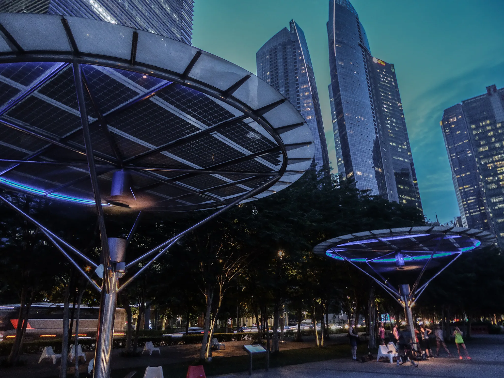

# Asia Neon - Theme for Omarchy

Purple and cyan neon lights of Singapore at night taken by myself (Gardens by the Bay, Marina Bay) on a deep violet-black background. The palette is extracted from my own photos, which are included as backgrounds.

## Install

```bash
omarchy theme install https://github.com/sspaeti/omarchy-asia-neon-theme
```

Or `SUPER + ALT + SPACE` → Install → Style → Theme → paste the URL.

## Preview


## Backgrounds



## Obsidian

A matching Obsidian theme with the same palette (dark and light mode): [Asia Neon for Obsidian](https://github.com/sspaeti/obsidian_asia_neon). Omarchy also generates an `Omarchy` Obsidian theme from `colors.toml` automatically, but the dedicated one has nicer headings, links and tables.

---

*Check also my other Omarchy theme, [Fireplace](https://github.com/sspaeti/omarchy-fireplace-theme), and my Obsidian themes [Kanagawa](https://github.com/sspaeti/obsidian_kanagawa), [Kanagawa Paper](https://github.com/sspaeti/obsidian_kanagawa_paper/), [Rosé Pine](https://github.com/sspaeti/obsidian_rose_pine/), [Osaka Jade](https://github.com/sspaeti/obsidian_osaka_jade).*
